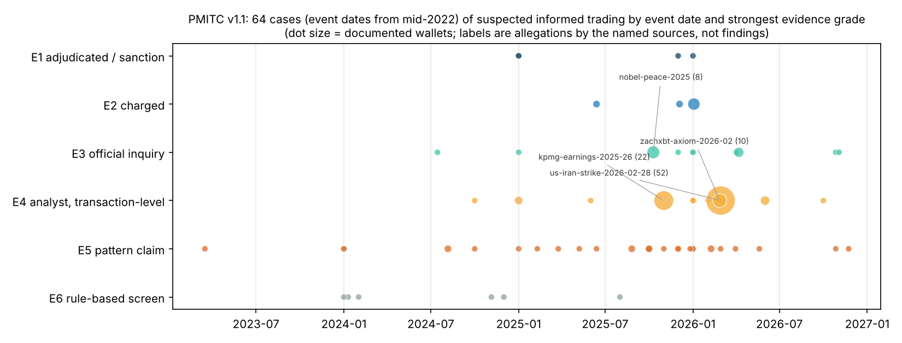

# PMITC v1.1: Prediction-Market Informed-Trading Casebook

PMITC is a source-traced register of **publicly documented, suspected** informed trading on prediction markets (Polymarket and Kalshi): 66 cases and 123 claims from courts, regulators, platforms, researchers, journalists and on-chain analysts, each graded E1 (adjudicated) to E6 (rule-based screen), joined to the trades. For every case market it ships every fill, every buyer before the news, matched controls, hard negatives, same-category "twin" markets and placebo markets where nobody can know the outcome early, so that detection methods can be trained and tested honestly. **Every label is an allegation by a named source ("flagged by <source>"), not a finding.** No table contains a personal name.



> **Read first.** (1) Labels are allegations; only E1 is adjudicated, and E1 is mostly Kalshi discipline without public wallets. (2) Positives are few and clustered: 19 wallets in `label_strict`, 119 in `label_broad`, and two cases hold 74 of the 119 broad positives. (3) The collection over-represents fresh wallets making large, cheap, well-timed bets on viral markets; do not estimate prevalence from it.

## Quick start

```python
import pandas as pd; positions = pd.read_parquet("data/positions.parquet", filters=[("t_news_version", "==", "precise")])
from datasets import load_dataset; wallets = load_dataset("<hf-user>/pmitc", "wallets", split="train")   # Hugging Face
print(positions.groupby("market_set").label_strict.sum(), wallets.num_rows)
```

Notebooks: `notebooks/01_quickstart.ipynb` (load, join, plot), `02_case_study.ipynb` (the Maduro market: price path, the wallet's buys, matched controls), `03_benchmarks.ipynb`. Requirements: `requirements.txt` (pinned); rebuilding from scratch takes about 7 hours and 30 GB of disk (`docs/REBUILD.md`).

## Tables

| Table | Rows | One row is |
|---|---|---|
| `cases` | 66 | One row per case (underlying event). Derived from claims (build/build_cases.py) plus market and wallet counts. |
| `claims` | 123 | One row per claim: one statement by one source at one time (PROTOCOL 2, 6). Claims are never edited; contradictions go to contradictions. |
| `wallets` | 260 | One row per (wallet, case) label. Labels are allegations by the named source, not findings. |
| `markets` | 1,118 | One row per (case, market). Ladders are full Gamma events (A6.5). Titles withheld where they name the alleged trader (A12.6). |
| `placebo_markets` | 4,495 | One row per placebo market (A14) with its matched case market; case-market rows that could not be matched appear with NULL placebo fields. |
| `fills` | 81,559,246 | Every leg of every fill in case and placebo markets, plus every leg of labelled wallets elsewhere. Parquet only (split into parts). |
| `positions` | 9,668,364 | All-buyer positions before the cut (C2): the full population a detector must search, case and placebo markets. |
| `episodes` | 17,499 | Per (wallet, market, token) episode of documented wallets and their matched controls; pre-news features, then _post outcomes. |
| `controls` | 16,603 | Matched controls (A6.10, seed 192) with relaxation flags, per t_news version. |
| `weak_labels` | 2,651,672 | Per wallet in Polymarket-v1: ACDC reconstruction and Inca rule (A6.9, E6), and Gate 1/2 counts (A16). Rule outputs, never merged with claims. |
| `market_minutes` | 2,013,043 | One row per market, version and UTC minute with fills, cut - 48 h to + 24 h, Yes token (A9.3, A10.2, A14). |
| `contradictions` | 5 | Places where the trades disagree with a claim (the claim is never edited), incl. the run-7 amount checks (gap > 10%). |
| `edges` | 416 | Money links between addresses from the seed sources (funding, Relay handoff, Safe owner, cash-out). Not expanded (A12.2). |
| `twin_markets` | 3,922 | One row per twin market (A22): a resolved market of the same category, volume decile, duration band and year as a case market, in no claim; unmatched case-market rows have NULL twin fields. |
| `hard_negatives` | 9,315 | One row per hard negative (A21): a position or wallet that matches the suspect profile but is a negative. |
| `claim_wallet_links` | 58 | One row per (claim, wallet, link type): how a claim names a wallet (A20). Used for wallet_grade and label_strict. |

Every column has a type, unit, allowed values, source and leakage note in `docs/CODEBOOK.md`. Parquet for all tables; CSV for tables under 50 MB. Keys: every table has a declared primary key; ids are stable (`case_id`, `claim_id`, `condition_id`, `asset_id`, `wallet`, `episode_id`). Timestamps are UTC; amounts carry units in their names (`_usdc`, `_shares`, `_price_usdc`, `_unix`, `_days`, `_hours`).

## Label sets (PROTOCOL A20)

| Set | Definition | Wallets | Cases |
|---|---|---|---|
| `label_strict` | trade-confirmed, informed trading, and either linked to an E1-E3 claim or named by address or resolved handle in an E4 claim | 19 | 7 |
| `label_standard` | trade-confirmed, informed trading, case grade E1-E4 (includes cluster members linked by money flows) | 112 | 11 |
| `label_broad` | trade-confirmed, informed trading, case grade E1-E5 (= `is_documented`) | 119 | 18 |

Lead with `label_strict`. Other label columns are kept separate and never merged: `hard_negative` (A21: 9,315 rows; look-alike losers, look-alike winners in placebo markets, cleared cases), `coordinated_rule_fired` (rule output; about 1/3 expected by chance; may include copy-traders; not an allegation), `gate1`/`gate2a`/`gate2b` (frozen screens), `acdc_class` (reconstruction, not a label), `inca_flag` (published rule only; broader than Inca's list), `is_control`, `is_placebo_market`, `is_twin_market`.

## News times

Every time-dependent table exists for two cut times (`t_news_version`): `day` (00:00 UTC on the earliest documented day) and `precise` (a sourced minute- or hour-level time, A10; used only inside the coarse date, A18). 17 of 42 market-bearing cases have an exact time; the rest fall back to the day.

## Benchmarks (PROTOCOL A23; `benchmarks/`)

Leave-one-case-out over cases with at least 3 `label_standard` wallets, plus a time split (test = cases first claimed on or after 2026-03-01). Cells: leave-one-case-out mean ± SD (number of folds) / time split; precise news times; seed 192. T1 ranks all pre-news buyers in a case market; T2 separates documented episodes from matched controls; T3 separates case markets from same-category twin markets; T3b from crypto/weather placebo markets (market-type sensitive).

| Task | Metric | Model | label_strict | label_standard | label_broad |
|---|---|---|---|---|---|
| T1 | AP, case-weighted | prevalence | 0.001 ± 0.001 (2) / 0.000 | 0.002 ± 0.000 (5) / 0.003 | 0.002 ± 0.000 (5) / 0.003 |
| T1 | AP, case-weighted | gate1_rule | 0.095 ± 0.088 (2) / 0.005 | 0.238 ± 0.204 (5) / 0.065 | 0.238 ± 0.204 (5) / 0.065 |
| T1 | AP, case-weighted | account_age_heuristic | 0.008 ± 0.007 (2) / 0.001 | 0.026 ± 0.029 (5) / 0.010 | 0.026 ± 0.029 (5) / 0.010 |
| T1 | AP, case-weighted | logistic_regression | 0.119 ± 0.038 (2) / 0.078 | 0.256 ± 0.183 (5) / 0.091 | 0.270 ± 0.171 (5) / 0.106 |
| T1 | AP, case-weighted | gradient_boosting_tuned | 0.091 ± 0.006 (2) / 0.074 | 0.319 ± 0.214 (5) / 0.090 | 0.265 ± 0.152 (5) / 0.060 |
| T2 | AUC, case-weighted | prevalence | 0.500 ± 0.000 (3) / 0.500 | 0.500 ± 0.000 (6) / 0.500 | 0.500 ± 0.000 (6) / 0.500 |
| T2 | AUC, case-weighted | gate1_rule | 0.844 ± 0.126 (3) / 0.704 | 0.680 ± 0.268 (6) / 0.569 | 0.680 ± 0.268 (6) / 0.569 |
| T2 | AUC, case-weighted | account_age_heuristic | 0.869 ± 0.115 (3) / 0.841 | 0.852 ± 0.085 (6) / 0.688 | 0.852 ± 0.085 (6) / 0.688 |
| T2 | AUC, case-weighted | logistic_regression | 0.743 ± 0.064 (3) / 0.738 | 0.775 ± 0.070 (6) / 0.827 | 0.781 ± 0.080 (6) / 0.824 |
| T2 | AUC, case-weighted | gradient_boosting_tuned | 0.859 ± 0.113 (3) / 0.817 | 0.862 ± 0.131 (6) / 0.808 | 0.860 ± 0.132 (6) / 0.714 |
| T3 | AUC, case-weighted | prevalence | 0.500 ± 0.000 (3) / 0.500 | 0.500 ± 0.000 (6) / 0.500 | 0.500 ± 0.000 (6) / 0.500 |
| T3 | AUC, case-weighted | gate1_rule | 0.696 ± 0.095 (3) / 0.687 | 0.675 ± 0.185 (6) / 0.494 | 0.675 ± 0.185 (6) / 0.494 |
| T3 | AUC, case-weighted | logistic_regression | 0.892 ± 0.105 (3) / 0.872 | 0.702 ± 0.231 (6) / 0.687 | 0.683 ± 0.312 (6) / 0.672 |
| T3 | AUC, case-weighted | gradient_boosting_tuned | 0.946 ± 0.041 (3) / 0.849 | 0.691 ± 0.246 (6) / 0.669 | 0.678 ± 0.308 (6) / 0.665 |
| T3b | AUC, case-weighted | prevalence | 0.500 ± 0.000 (3) / 0.500 | 0.500 ± 0.000 (6) / 0.500 | 0.500 ± 0.000 (6) / 0.500 |
| T3b | AUC, case-weighted | gate1_rule | 0.483 ± 0.301 (3) / 0.497 | 0.613 ± 0.295 (6) / 0.505 | 0.613 ± 0.295 (6) / 0.505 |
| T3b | AUC, case-weighted | logistic_regression | 0.929 ± 0.091 (3) / 0.866 | 0.931 ± 0.054 (6) / 0.923 | 0.930 ± 0.057 (6) / 0.929 |
| T3b | AUC, case-weighted | gradient_boosting_tuned | 0.996 ± 0.006 (3) / 0.733 | 0.956 ± 0.045 (6) / 0.947 | 0.868 ± 0.212 (6) / 0.849 |

Base result for T2: matched same-side controls win about as often as documented episodes, so outcomes cannot separate them. Full per-fold results, leakage lists and the known shortcuts are in `benchmarks/README.md` and `benchmarks/baselines.json`.

## Coverage

- Cases by grade: E1 4, E2 3, E3 10, E4 13, E5 28, E6 8. Investigation outcome: unresolved 44, under_investigation 10, sanctioned 4, charged 3, cleared_analyst 2, disputed 2, cleared_official 1.
- Claims: 123 (108 verified by reading the source page, 15 pending).
- Twin markets: 3,508; placebo markets: 4,227.
- Trades: Polymarket-v1 (Hugging Face, 746 M fills to 2026-04-28) and the Polymarket Data API v2 after that. Kalshi trades and accounts are not public here.

## Limitations

- Labels are allegations by sources; grades say how strong the source is, not whether trading was informed.
- Selection bias (PROTOCOL 8): what was noticed and published. Ordinary-looking informed trading is missing.
- Few, clustered positives; results on 1-6 test cases are noisy. Report per case and case-weighted.
- Cluster members (`label_standard`) are linked by money flows, not flagged one by one.
- The money graph is not built (no archive Polygon RPC); funding features are empty.
- 15 claims are pending (pages blocked or unread); the blind second-extractor check (A4) is pending.
- Rule outputs (coordinated-buyer rule, Gate 1, ACDC, Inca) are screens with known false-positive rates, not labels.

## Ethics, data protection and removal

No personal names; no identity work; market titles naming listed people are withheld. Pseudonymous addresses can be personal data: see `docs/DATA_PROTECTION.md` (lawful basis, minimisation, retention, rights). To submit a case, correct a row or request removal, see `CONTRIBUTING.md`. A subject's reply is recorded in `claims.right_of_reply`. How claims were extracted (an AI model under a written protocol) and the blind-check status: `docs/EXTRACTION.md`.

## Licence

CC-BY-4.0 for PMITC tables and docs; MIT for code. Polymarket-v1 (TimeSeventeen, CC-BY-4.0) for `source = hf_polymarket_v1` fills. Upstream licences: `docs/LICENSES_UPSTREAM.md`.

## How to cite

> Yildiz, I. (2026). *Prediction-Market Informed-Trading Casebook (PMITC)*, version 1.1.0 [dataset]. Protocol v1.0 with amendments A1 to A24. https://github.com/ibrhmyi/insider

See `docs/CITATION.cff`. Please also cite Polymarket-v1 for the fills.
