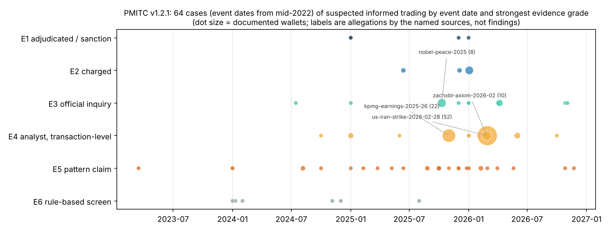

> **release_safe (v1.0.1).** This package omits the fill files with `source = data_api_v2` (Polymarket Data API rows,
> whose redistribution terms were not verified). All other tables are identical to the full package; tables derived from
> those rows (`positions`, `episodes`, `controls`, `market_minutes`) still contain their aggregates. Rebuild the omitted
> files with `python3 scripts/rebuild_data_api_fills.py` (public API; results will differ slightly from the full package
> because the API keeps adding rows).

# PMITC v1.2.1: Prediction-Market Informed-Trading Casebook

PMITC is a source-traced register of **publicly documented, suspected** informed trading on prediction markets (Polymarket and Kalshi): 66 cases and 124 claims from courts, regulators, platforms, researchers, journalists and on-chain analysts, each graded E1 (adjudicated) to E6 (rule-based screen), joined to the trades. For every case market it ships every fill, every buyer before the news, matched controls, hard negatives, same-category "twin" markets and placebo markets where nobody can know the outcome early, so that detection methods can be trained and tested honestly. **Every label is an allegation by a named source ("flagged by <source>"), not a finding.** No table contains a personal name.



> **Read first.** (1) Labels are allegations; only E1 is adjudicated, and E1 is mostly Kalshi discipline without public wallets. (2) Positives are few and clustered: 19 wallets in `label_strict`, 119 in `label_broad`, and two cases hold 74 of the 119 broad positives. (3) The collection over-represents fresh wallets making large, cheap, well-timed bets on viral markets; do not estimate prevalence from it.

## Quick start

```python
import pandas as pd; positions = pd.read_parquet("data/positions.parquet", filters=[("t_news_version", "==", "precise"), ("t_news_reliable", "==", True)])  # A29 default
from datasets import load_dataset; wallets = load_dataset("<hf-user>/pmitc", "wallets", split="train")   # Hugging Face
print(positions.groupby("market_set").label_strict.sum(), wallets.num_rows)
```

Notebooks: `notebooks/01_quickstart.ipynb` (load, join, plot), `02_case_study.ipynb` (the Maduro market: price path, the wallet's buys, matched controls), `03_benchmarks.ipynb`. Requirements: `requirements.txt` (pinned); rebuilding from scratch takes about 7 hours and 45 GB of disk (`docs/REBUILD.md`).

## Tables

| Table | Rows | One row is |
|---|---|---|
| `cases` | 66 | One row per case (underlying event). Derived from claims (build/build_cases.py) plus market and wallet counts. |
| `claims` | 124 | One row per claim: one statement by one source at one time (PROTOCOL 2, 6). Claims are never edited; contradictions go to contradictions. |
| `wallets` | 260 | One row per (wallet, case) label. Labels are allegations by the named source, not findings. |
| `markets` | 1,107 | One row per (case, market). Ladders are full Gamma events (A6.5). Titles withheld where they name the alleged trader (A12.6). |
| `placebo_markets` | 4,440 | One row per placebo market (A14) with its matched case market; case-market rows that could not be matched appear with NULL placebo fields. |
| `fills` | 65,595,598 | Every leg of every fill in case and placebo markets, plus every leg of labelled wallets elsewhere. Parquet only (split into parts). |
| `positions` | 15,158,094 | All-buyer positions before the cut (C2): the full population a detector must search, case and placebo markets. |
| `episodes` | 60,162 | Per (wallet, market, token) episode of documented wallets and their matched controls; pre-news features, then _post outcomes. |
| `controls` | 56,398 | Matched controls (A6.10, seed 192) with relaxation flags, per t_news version. |
| `weak_labels` | 2,651,672 | Per wallet in Polymarket-v1: ACDC reconstruction and Inca rule (A6.9, E6), and Gate 1/2 counts (A16). Rule outputs, never merged with claims. |
| `market_minutes` | 1,765,726 | One row per market, version and UTC minute with fills, cut - 48 h to + 24 h (A9.3, A10.2, A14). Prices (vwap, last_price) are of the Yes token, or of the first listed outcome where there is no Yes (A44); volumes cover both tokens; raw fills. |
| `contradictions` | 5 | Places where the trades disagree with a claim (the claim is never edited), incl. the run-7 amount checks (gap > 10%). |
| `edges` | 416 | Money links between addresses from the seed sources (funding, Relay handoff, Safe owner, cash-out). Not expanded (A12.2). |
| `twin_markets` | 3,089 | One row per twin market (A22, A38): a resolved market of the same category and question type, volume decile, duration band and year as a case market, never a placebo category or the same subject, in no claim; unmatched case-market rows have NULL twin fields. |
| `hard_negatives` | 11,593 | One row per hard negative (A21): a position or wallet that matches the suspect profile but is a negative. |
| `claim_positions` | 178 | A35: one row per (claim, market, side) a claim describes, mapped by hand from claim text and market questions without looking at outcomes. |
| `claim_wallet_links` | 58 | One row per (claim, wallet, link type): how a claim names a wallet (A20). Used for wallet_grade and label_strict. |

Every column has a type, unit, allowed values, source and leakage note in `docs/CODEBOOK.md`. Parquet for all tables; CSV for tables under 50 MB. Keys: every table has a declared primary key; ids are stable (`case_id`, `claim_id`, `condition_id`, `asset_id`, `wallet`, `episode_id`). Timestamps are UTC; amounts carry units in their names (`_usdc`, `_shares`, `_price_usdc`, `_unix`, `_days`, `_hours`).

## Label sets (PROTOCOL A20)

| Set | Definition | Wallets | Cases |
|---|---|---|---|
| `label_standard` (main training label) | trade-confirmed, informed trading, case grade E1-E4 (includes cluster members linked by money flows) | 112 | 11 |
| `label_strict` (evaluation only) | label_standard, linked to an E1-E3 claim or named by address or resolved handle in an E4 claim, with a buy before the precise news time | 19 | 7 |
| `label_broad` | trade-confirmed, informed trading, case grade E1-E5 (= `is_documented`) | 119 | 18 |

**`label_standard` is the main training label; `label_strict` is evaluation-only** (models are trained on `label_standard` and scored on strict positives, A26). `label_strict` also needs a buy before the market's precise news time; 0 wallet(s) meet the rest of the rule without one (`strict_no_prenews`). Other label columns are kept separate and never merged: `hard_negative` (A21: 11,593 rows; look-alike losers, look-alike winners in placebo markets, cleared cases), `coordinated_rule_fired` (rule output; about 1/3 expected by chance; may include copy-traders; not an allegation), `gate1`/`gate2a`/`gate2b` (frozen screens), `acdc_class` (reconstruction, not a label), `inca_flag` (published rule only; broader than Inca's list), `is_control`, `is_placebo_market`, `is_twin_market`.

**Positives are alleged positions (A35).** A wallet's alleged positions are the (market, side) pairs its own claims, or its cluster's claims, describe (`claim_positions`, mapped from claim text and market questions only; A35.1, A48). Of 527 pre-news positions of labelled wallets in their own cases (precise cut), 143 are alleged; the other 384 are `role = labelled_other_position` in `episodes` and are not positives. All 39 losing suspected-side positions are labelled-other positions; no alleged position lost. On alleged positions: `label_strict` 21 positions from 16 wallets in 6 cases, `label_standard` 140 from 79 wallets in 8 cases, `label_broad` 143 from 82 wallets in 11 cases. 35 labelled wallets drop out (30 because no claim names a market or side, e.g. all of `kpmg-earnings-2025-26` and `world-cup-2026-06`; 5 because they held no alleged market and side before the cut; `logs/a35_dropouts.csv`). The wallet-level version (any position of a labelled wallet) is reported as secondary (`baselines.json`, `wallet_level`).

## News times

Every time-dependent table exists for two cut times (`t_news_version`): `day` and `precise`. Cuts are **per market** (A25): a Gamma scheduled start (matches, earnings releases), a market deadline inside a coarse case date, or else the case time; the case-level `t_news_utc` (00:00 UTC of the earliest documented day) and `t_news_precise_utc` (a sourced minute- or hour-level time, A10, inside the coarse date, A18) are kept. 17 of 42 market-bearing cases have an exact time; the rest fall back to the day. A scheduled start is used only if it is before the market's close (A30).

**`t_news_reliable` (A29, A29.1).** A market whose cut came from the deadline rule (a coarse case date and nothing better for that market) has no trustworthy cut: `t_news_reliable = false` (the deadline time is kept as `markets.t_news_deadline_rule_utc`). Sourced exact times and checked scheduled starts are reliable; markets that fall back to the case date keep `true` (their cut is the start of the documented period, earlier than the news). **Default analyses and every benchmark use `t_news_reliable = true` only.** This removes 355 of 1107 markets: whole cases `ballon-dor-2026`, `biden-pardons`, `draftkings-pm-launch`, `fed-chair-nomination-2026`, `ftx-sbf`, `mstr-btc-sale`, `openai-browser-2025-10`, `romania-2024`, `spotify-wrapped-2025`, `trump-pardon-cz-2025`, `tweet-count-self-2026-03`; part of . Of the documented wallets with a pre-news position it keeps 19 of 19 strict, 109 of 111 standard and 112 of 117 broad.

## Benchmarks (PROTOCOL A23, A26, A27, A29, A32, A33, A34; `benchmarks/`)

Leave-one-group-out over connected case groups (A37: cases sharing a market or Gamma event are one group) with at least 3 `label_standard` wallets, plus a time split by group (test = groups first claimed on or after 2026-03-01). Positives are alleged positions (A35). Only `t_news_reliable = true` markets (A29) and directional pre-news positions in the economic view (A34-A34.2). Cells: case-weighted leave-one-case-out mean ± SD (number of folds) / time split; precise news times; seed 192. **With fewer than 6 folds (A32) a cell gives only the range of fold values** ("folds min-max (n) / time split"); per-fold values are in `baselines.json`. This applies to every `label_strict` cell. With alleged positions as positives (A35) and whole groups as folds (A37), `label_standard` and `label_broad` also have fewer than 6 folds (label_standard: 4, label_broad: 4), so **every cell is a range of fold values**. **The time split is empty for every label set:** no group first claimed on or after 2026-03-01 has an alleged position before a reliable cut, so all results are leave-one-group-out folds. **`label_strict` has fewer than 4 usable leave-one-group-out folds** (T1s: 3, T2s: 3, T2w: 3, T2open: 3; plus the time split): strict results are anecdotal, one fold can move the range by more than any model difference, and no strict number should be read as a detector's accuracy. Models train on `label_standard` (`label_broad` for its own column); the `label_strict` column scores the same models on strict positives.

**Headline tasks control for how sources select cases (A27):** **T1s** ranks pre-news buyers only within the size band of the market's positives (size alone no longer separates them); **T2s** matches controls on account-age band as well as time, price and size; **T2w** matches on account-age and prior win-rate bands (A33); both retry with the adjacent band before dropping an episode (`relaxed_band`); **T2-open** lets Orca/Inca-flagged wallets be controls. Secondary: T1 (all buyers), T2 (standard controls), T3 (case vs same-category twin markets), T3b (case vs crypto/weather placebo markets; market-type sensitive).

| Task | Metric | Model | label_standard | label_strict (eval only) | label_broad |
|---|---|---|---|---|---|
| T1s | AP | prevalence | folds 0.020-0.148 (4) / n/a | folds 0.004-0.059 (3) / n/a | folds 0.020-0.148 (4) / n/a |
| T1s | AP | gate1_rule | folds 0.216-0.844 (4) / n/a | folds 0.090-1.000 (3) / n/a | folds 0.216-0.844 (4) / n/a |
| T1s | AP | account_age_heuristic | folds 0.088-0.696 (4) / n/a | folds 0.043-0.333 (3) / n/a | folds 0.088-0.696 (4) / n/a |
| T1s | AP | logistic_regression | folds 0.312-0.729 (4) / n/a | folds 0.144-1.000 (3) / n/a | folds 0.319-0.725 (4) / n/a |
| T1s | AP | gradient_boosting_tuned | folds 0.128-0.975 (4) / n/a | folds 0.073-1.000 (3) / n/a | folds 0.137-0.925 (4) / n/a |
| T2s | AUC | prevalence | folds 0.500-0.500 (4) / n/a | folds 0.500-0.500 (3) / n/a | folds 0.500-0.500 (4) / n/a |
| T2s | AUC | gate1_rule | folds 0.706-0.994 (4) / n/a | folds 0.744-1.000 (3) / n/a | folds 0.706-0.994 (4) / n/a |
| T2s | AUC | account_age_heuristic | folds 0.566-0.645 (4) / n/a | folds 0.100-0.566 (3) / n/a | folds 0.566-0.645 (4) / n/a |
| T2s | AUC | logistic_regression | folds 0.552-1.000 (4) / n/a | folds 0.774-1.000 (3) / n/a | folds 0.521-1.000 (4) / n/a |
| T2s | AUC | gradient_boosting_tuned | folds 0.552-1.000 (4) / n/a | folds 0.920-1.000 (3) / n/a | folds 0.406-1.000 (4) / n/a |
| T2w | AUC | prevalence | folds 0.500-0.500 (4) / n/a | folds 0.500-0.500 (3) / n/a | folds 0.500-0.500 (4) / n/a |
| T2w | AUC | gate1_rule | folds 0.716-1.000 (4) / n/a | folds 0.752-1.000 (3) / n/a | folds 0.716-1.000 (4) / n/a |
| T2w | AUC | account_age_heuristic | folds 0.464-0.700 (4) / n/a | folds 0.000-0.459 (3) / n/a | folds 0.464-0.700 (4) / n/a |
| T2w | AUC | logistic_regression | folds 0.450-1.000 (4) / n/a | folds 0.809-1.000 (3) / n/a | folds 0.442-1.000 (4) / n/a |
| T2w | AUC | gradient_boosting_tuned | folds 0.583-1.000 (4) / n/a | folds 0.885-1.000 (3) / n/a | folds 0.375-1.000 (4) / n/a |
| T2open | AUC | prevalence | folds 0.500-0.500 (4) / n/a | folds 0.500-0.500 (3) / n/a | folds 0.500-0.500 (4) / n/a |
| T2open | AUC | gate1_rule | folds 0.821-0.972 (4) / n/a | folds 0.849-1.000 (3) / n/a | folds 0.821-0.972 (4) / n/a |
| T2open | AUC | account_age_heuristic | folds 0.783-0.977 (4) / n/a | folds 0.766-1.000 (3) / n/a | folds 0.783-0.977 (4) / n/a |
| T2open | AUC | logistic_regression | folds 0.655-0.963 (4) / n/a | folds 0.834-1.000 (3) / n/a | folds 0.655-0.967 (4) / n/a |
| T2open | AUC | gradient_boosting_tuned | folds 0.792-0.995 (4) / n/a | folds 0.827-1.000 (3) / n/a | folds 0.841-1.000 (4) / n/a |
| T1 | AP | prevalence | folds 0.001-0.005 (4) / n/a | folds 0.000-0.003 (3) / n/a | folds 0.001-0.005 (4) / n/a |
| T1 | AP | gate1_rule | folds 0.052-0.830 (4) / n/a | folds 0.005-0.500 (3) / n/a | folds 0.052-0.830 (4) / n/a |
| T1 | AP | account_age_heuristic | folds 0.002-0.058 (4) / n/a | folds 0.000-0.032 (3) / n/a | folds 0.002-0.058 (4) / n/a |
| T1 | AP | logistic_regression | folds 0.180-0.908 (4) / n/a | folds 0.071-1.000 (3) / n/a | folds 0.185-0.853 (4) / n/a |
| T2 | AUC | prevalence | folds 0.500-0.500 (4) / n/a | folds 0.500-0.500 (3) / n/a | folds 0.500-0.500 (4) / n/a |
| T2 | AUC | gate1_rule | folds 0.835-0.990 (4) / n/a | folds 0.855-1.000 (3) / n/a | folds 0.835-0.990 (4) / n/a |
| T2 | AUC | account_age_heuristic | folds 0.788-0.980 (4) / n/a | folds 0.783-1.000 (3) / n/a | folds 0.788-0.980 (4) / n/a |
| T2 | AUC | logistic_regression | folds 0.686-0.969 (4) / n/a | folds 0.839-1.000 (3) / n/a | folds 0.689-0.969 (4) / n/a |
| T3 | AUC | prevalence | folds 0.500-0.500 (3) / n/a | folds 0.500-0.500 (2) / n/a | folds 0.500-0.500 (3) / n/a |
| T3 | AUC | gate1_rule | folds 0.333-1.000 (3) / n/a | folds 0.200-0.975 (2) / n/a | folds 0.333-1.000 (3) / n/a |
| T3 | AUC | logistic_regression | folds 1.000-1.000 (3) / n/a | folds 1.000-1.000 (2) / n/a | folds 0.833-1.000 (3) / n/a |
| T3 | AUC | gradient_boosting_tuned | folds 0.500-1.000 (3) / n/a | folds 0.500-1.000 (2) / n/a | folds 0.500-1.000 (3) / n/a |
| T3b | AUC | prevalence | folds 0.500-0.500 (4) / n/a | folds 0.500-0.500 (3) / n/a | folds 0.500-0.500 (4) / n/a |
| T3b | AUC | gate1_rule | folds 0.200-1.000 (4) / n/a | folds 0.200-1.000 (3) / n/a | folds 0.200-1.000 (4) / n/a |
| T3b | AUC | logistic_regression | folds 0.900-1.000 (4) / n/a | folds 1.000-1.000 (3) / n/a | folds 0.900-1.000 (4) / n/a |
| T3b | AUC | gradient_boosting_tuned | folds 0.950-1.000 (4) / n/a | folds 0.971-1.000 (3) / n/a | folds 0.962-1.000 (4) / n/a |

Base result for T2: matched same-side controls win about as often as documented episodes, so outcomes cannot separate them. Full per-fold results, leakage lists and the known shortcuts are in `benchmarks/README.md` and `benchmarks/baselines.json`.

## Coverage

- Cases by grade: E1 4, E2 3, E3 10, E4 13, E5 28, E6 8. Investigation outcome: unresolved 44, under_investigation 10, sanctioned 4, charged 3, cleared_analyst 2, disputed 2, cleared_official 1.
- Claims: 124 (109 verified by reading the source page, 15 pending).
- Twin markets: 2,486 for 464 case markets (A46: chosen from the full Polymarket-v1 catalog with the A38 question-type and subject rules; Data-API-era case markets have no catalog category and get no twins); placebo markets: 4,172.
- Claim timing (A42, A49): 9 claims were published before their alleged market resolved (`ex_ante`); the alleged side won in 8 of 9. Only 2 of them are dated a full day before the resolution (1 won); the others are dated on the resolution day (`claim_day_contains_resolution`). The March 31 ceasefire flag (CL0031) is the clearest ex-ante claim, and its market resolved No.
- Trades: Polymarket-v1 (Hugging Face, 746 M fills to 2026-04-28) and the Polymarket Data API v2 after that. Kalshi trades and accounts are not public here.

## Limitations

- Labels are allegations by sources; grades say how strong the source is, not whether trading was informed.
- Selection bias (PROTOCOL 8): what was noticed and published. Ordinary-looking informed trading is missing.
- Few, clustered positives; results on 1-6 test cases are noisy. Report per case and case-weighted.
- Cluster members (`label_standard`) are linked by money flows, not flagged one by one.
- The money graph is not built (no archive Polygon RPC); funding features are empty.
- 15 claims are pending (pages blocked or unread); the blind second-extractor check (A4) is pending.
- Rule outputs (coordinated-buyer rule, Gate 1, ACDC, Inca) are screens with known false-positive rates, not labels.
- In the strict Maduro fold (one positive), results rest on a single wallet; see the per-fold values in `baselines.json`.
- Positions are economic and net of full sets (A34-A34.2): a SELL of a token the wallet did not hold is read as a BUY of the other token, and a held Yes + No pair counts as no direction. The raw fills are unchanged and the raw view stays comparable (`raw_view_prenews_buy`, `econ_inferred_buy_usdc_pre`). Merges cannot be inferred from fills, so some full sets come from buys of both tokens. In this view 111 of 112 `label_standard` wallets have a directional pre-news position in their case. The share of directional pre-news positions that exist only in the economic view is 35% in case markets, 41% in twins and 51% in placebos (precise cut; the same for non-market-makers): the re-reading is market mechanics, not a case-market signal.
- `is_market_maker` is a reporting flag with a simple rule (both tokens traded in most active minutes); it also flags some large one-way buyers (see the run-11 report).

## Ethics, data protection and removal

No personal names; no identity work; market titles naming listed people are withheld. Pseudonymous addresses can be personal data: see `docs/DATA_PROTECTION.md` (lawful basis, minimisation, retention, rights). To submit a case, correct a row or request removal, see `CONTRIBUTING.md`. A subject's reply is recorded in `claims.right_of_reply`. How claims were extracted (an AI model under a written protocol) and the blind-check status: `docs/EXTRACTION.md`.

## Licence

CC-BY-4.0 for PMITC tables and docs; MIT for code. Polymarket-v1 (TimeSeventeen, CC-BY-4.0) for `source = hf_polymarket_v1` fills. Upstream licences: `docs/LICENSES_UPSTREAM.md`.

## How to cite

> Yildiz, I. (2026). *Prediction-Market Informed-Trading Casebook (PMITC)*, version 1.2.1 [dataset]. Protocol v1.0 with amendments A1 to A49. https://github.com/ibrhmyi/insider

See `docs/CITATION.cff`. Please also cite Polymarket-v1 for the fills.
